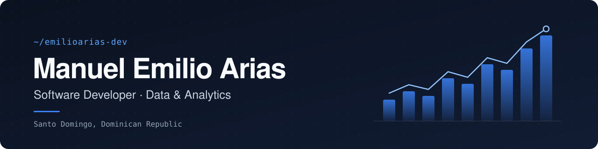

  

  
  
  

 

I build software and data systems that operations teams actually use.

I started in data — analytics, ETL, and automation inside a GMP-regulated manufacturing plant — and now work as a software developer shipping full-stack TypeScript. That mix is the point: I write the product *and* understand the data behind it.

 

## Now

- **Associate Software Developer at Rivero** — building with Next.js, NestJS, Prisma, and PostgreSQL.
- Leading the go-live of **riveroco.com**: one bilingual (EN/ES) corporate site that unifies three separate company websites and replaces the previous Webflow build.
- Finishing a **B.S. in Computer Science Engineering** at PUCMM.

 

## Experience

**Associate Software Developer — Rivero** 
Nov 2026 – Present · Remote

- Full-stack development in TypeScript across a Next.js front end and a NestJS + Prisma + PostgreSQL back end.
- Project lead for the riveroco.com website go-live (EN + ES).
- Ticket-driven delivery with pull-request review, in an AI-assisted engineering workflow.

**Data & Automation Technician — Fresenius Kabi Medical** 
May 2025 – Present · Santo Domingo, Dominican Republic

- Built internal data and automation tools in Python, adopted by ~20 engineers and operations staff in a GMP-regulated environment.
- Analyze real-time operational data and define the KPIs used for day-to-day decisions.
- Own ETL, data transformation, and data-quality monitoring for operational reporting.

 

## Stack

| | |
|---|---|
| **Product engineering** | TypeScript · Next.js · React · NestJS · Prisma · PostgreSQL |
| **Data & ML** | Python · SQL · Pandas · NumPy · scikit-learn · R · Databricks |
| **BI & reporting** | Power BI · KPI design · Executive dashboards |
| **Also comfortable in** | C# · C++ · MySQL · SQLite |
| **Workflow** | Git · GitHub · Linear · Cursor · Jupyter · VS Code |

 

## Selected work

| Project | What it does | Stack |
|---|---|---|
| **Inventory Segmentation & Profit Optimization** | ETL pipeline, feature engineering, and inventory segmentation to surface profitability decisions. | Python · SQL · Databricks |
| **Data Engineering Pipeline** | End-to-end ETL with data transformation and automated reporting. | Python · SQL · SQLite |
| **Breast Cancer Classification** | ML classification pipeline on the Wisconsin Breast Cancer dataset, from EDA to model evaluation. | Python · scikit-learn |
| **Business Intelligence Dashboard** | Interactive KPI tracking and executive reporting. | Power BI |

 

## Education

- **B.S. Computer Science Engineering** — PUCMM *(in progress)*
- **Technical Degree in Data Analytics** — Universidad CENFOTEC

Spanish (native) · English (C1)

 

---

  Open to conversations about software, data, and the space where they meet.

